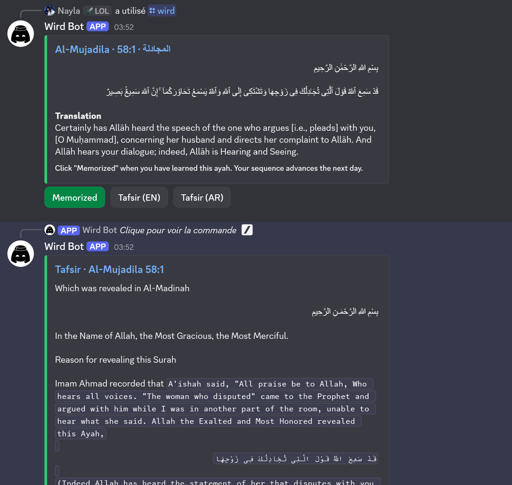

# Wird

**[Add Wird to your Discord server](https://discord.com/oauth2/authorize?client_id=1572037133248761926&permissions=2147535872&integration_type=0&scope=applications.commands+bot)**

A Discord bot for memorising the Qur'an one ayah at a time.



## Features

- Choose a plan: memorise the whole Qur'an in order, or focus on one surah.
- Each person's plan and progress are separate. Your current ayah stays until you mark it memorised; the next ayah is available the following day.
- After finishing a surah plan, choose another with `/plan`.
- View Arabic text, English translation, and tafsir.
- Check your progress and server leaderboard.

Ayah text and tafsir are fetched from the [Quran.com API](https://api.quran.com/api/v4). The tafsir buttons use **Tafsir Ibn Kathir** in English (ID 169) and **Tafsir al-Muyassar** in Arabic (ID 16).

## Setup

1. Install [Rust](https://rustup.rs). On Windows, you may also need [Visual Studio Build Tools](https://visualstudio.microsoft.com/visual-cpp-build-tools/) with the **Desktop development with C++** workload.
2. Create a bot in the [Discord Developer Portal](https://discord.com/developers/applications), then authorize it using the invite link above. It needs **View Channels**, **Send Messages**, and **Embed Links** permissions.
3. Copy `.env.example` to `.env` and add your bot token:

   ```powershell
   Copy-Item .env.example .env
   notepad .env
   ```

   Keep `.env` private. Set `GUILD_ID` to your test server's ID for faster slash-command updates.
4. Start the bot:

   ```powershell
   cargo run
   ```

## Commands

| Command | Description |
| --- | --- |
| `/plan` | Choose a whole-Qur'an or single-surah memorization plan |
| `/wird` | Show your current ayah and tafsir buttons |
| `/progress` | View your memorization total and streak |
| `/leaderboard` | View the server leaderboard |

Run `cargo test` to run the tests. Memorization data is stored in `wird.db`; keep that file on persistent storage when hosting the bot.
